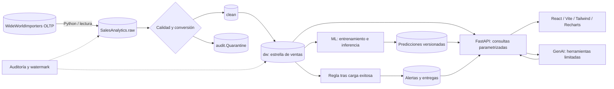

# Arquitectura y decisiones iniciales

Estado de la tercera etapa: fuente/raw/clean/DW, incremental/SCD, API, dashboard,
monitoreo, pronóstico semanal, asistente Ollama y alertas persistidas implementados.
Evidencias y límites: [revisión del día 3](revision-dia3.md).

- Una instancia SQL Server Developer 2022, dos bases: fuente y analítica.
  El aislamiento lógico evita consultar la fuente para construir indicadores y reduce memoria.
- `raw` conservará recepción por ejecución; `clean` validará e integrará;
  `dw` resolverá dimensiones y hechos; `audit` registrará ejecución, rechazos y watermark.
  La zona ready de la guía puede ser una vista controlada en clean, sin servicio adicional.
- Python ejecutará el batch. La frecuencia inicial es bajo demanda; programación con
  tarea Windows en día 2 si aporta a la demostración. No se afirma tiempo real.
- Claves y fórmulas pendientes de inspección. No usar el DW de ejemplo preconstruido.
- API con usuario de solo lectura; ETL con permisos de carga; administración solo para bootstrap.
- Ollama local con Qwen2.5 1.5B seleccionado tras prueba CPU/memoria/calidad; sin API paga.
- Esquema `ml`: versión y predicciones; `notify`: tareas, evaluaciones, alertas e historial.
- La API consulta con lector de vistas. Una cuenta separada de eventos inserta auditoría
  y ejecuta procedimientos acotados de entrega/estado, sin escritura de hechos.
- Sin alojamiento externo, correo ni mensajería inicialmente. Panel web como canal de alerta.

## Preguntas de negocio iniciales

1. ¿Cómo evolucionan las ventas facturadas por semana y mes?
2. ¿Qué productos y clientes explican los importes del período seleccionado?
3. ¿Cuántas facturas y unidades componen las ventas y cuál es el ticket medio?
4. ¿Cómo cambia un período frente al anterior comparable?
5. ¿Hay historia suficiente para prever ventas semanales y detectar una caída?

Las medidas distinguirán base imponible, impuestos, total y documentos de crédito según
la semántica comprobada en fuente. Una fecha sin actividad no equivale automáticamente
a un cero: primero comprobar cobertura del calendario y cierre de períodos.
