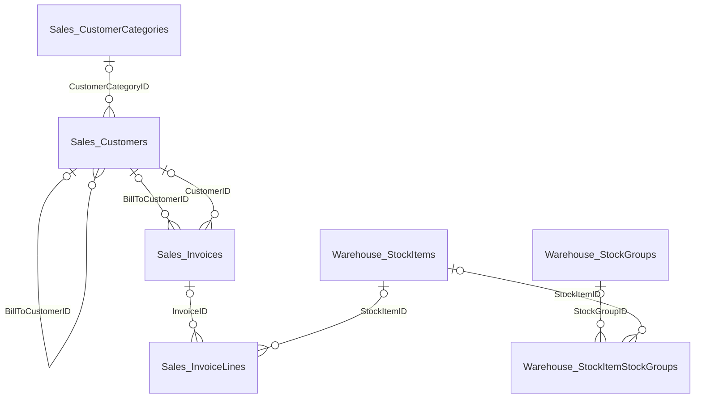

# ERD de fuente — relaciones del catálogo real

El marcador 0/1 representa opcionalidad conservadora; consultar nullable y FK en el diccionario.
Se muestran las tablas del alcance inspeccionado; relaciones externas quedan en source-profile.json.
