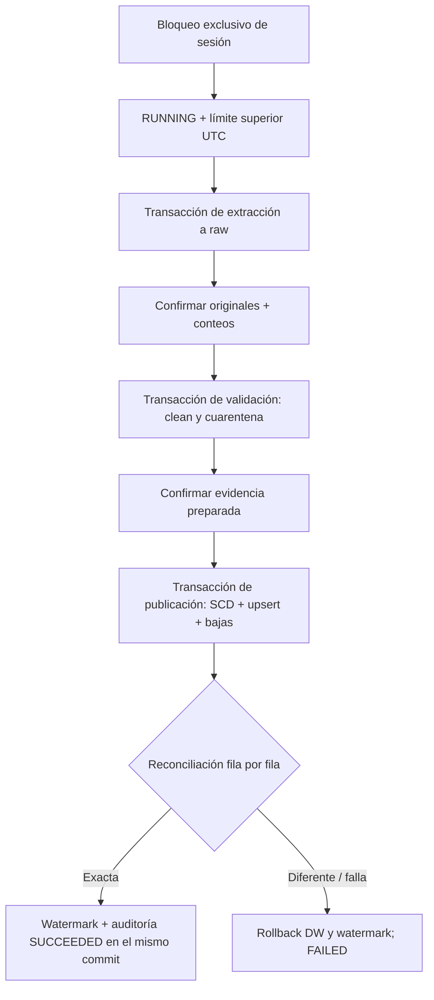

# Incremental, SCD y recuperación

Implementado y probado en la segunda etapa. Fuente operacional principal sin modificaciones.

## Detección y contrato de fuente

Facturas/líneas tienen LastEditedWhen; sus cambios se extraen con una ventana de solapamiento
de 48 horas desde el watermark previo. Un cambio de cabecera vuelve a extraer sus líneas.
Además se buscan claves nuevas o hechos no activos, aunque su fecha de negocio y su marca
de edición sean antiguas. La fecha de factura nunca se usa como watermark.

Clientes/categorías/productos son pequeños (663/8/227 en la muestra) y se leen completos en cada
ejecución. Así se captan cambios de atributos sin exigir permisos adicionales sobre archivos
temporales. La inspección encontró versiones de clientes, pero sin cambios de nombre/categoría;
no se importaron versiones correspondientes a atributos fuera del alcance.

La extracción de medidas es incremental; la verificación global compara filas en ambos sentidos
mediante EXCEPT, incluyendo claves naturales, fecha y todas las medidas. Esto cuesta una lectura
completa de validación, aceptable para 228.265 líneas y útil para evitar diferencias compensadas
en sumas. Una actualización con marca fuera del solapamiento provoca fallo explícito y se repara
con `python -m etl.run_incremental --full`. No se omite silenciosamente.

LastEditedWhen debe mantenerse al corregir operaciones. Sin CDC no se promete extraer por tiempo
una corrección arbitrariamente retrodatada: la reconciliación la detecta y la carga completa la resuelve.
Reloj del servidor y watermark incoherentes hacen fallar la carga en lugar de retroceder la marca.

## Transacciones y auditoría



Raw y rechazos preparados sobreviven a una falla posterior. Clean es staging, no una interfaz de
consumo público. Las vistas aprobadas leen únicamente DW activo. Reejecutar crea otro UUID y
otro snapshot de lo recibido, pero solo modifica hechos que cambiaron. Se conservan los originales.

RowsRead suma filas extraídas de las cinco entidades; RowsInserted/RowsUpdated cuentan hechos
nuevos/corregidos o cambios de estado. StageCount separa objetos y contabiliza también dimensiones,
versiones insertadas/expiradas, clean y rechazos. Reconciliation distingue delta de total global.
WatermarkStart registra el inicio efectivo del solapamiento; WatermarkEnd el límite candidato.
`audit.Watermark` contiene únicamente el límite confirmado por una publicación exitosa.

## Política SCD

Cliente es Tipo 2 para nombre y clasificación comercial (ID/nombre de categoría). Una dimensión
vigente por clave natural, índice filtrado único e intervalos ObservedFrom/ObservedTo no solapados.
El inicio significa **observado por la plataforma**, no fecha efectiva de negocio en 2013–2016.
La migración parte del snapshot que ya se tenía; no inventa categorías anteriores a esa observación.

Los hechos conservan la versión de cliente conocida al primer ingreso. Corregir medidas del mismo
cliente no reclasifica ventas anteriores; cambiar realmente el cliente de la factura resuelve su
versión vigente. Una nueva línea tardía usa el conocimiento disponible al ingresar y no pretende
reconstruir la categoría que tenía el cliente en la fecha original. La aplicación documenta este límite.

Producto es Tipo 1: etiquetas del catálogo se actualizan, pero cantidades/precios facturados se
conservan en el hecho. Fecha es determinista; desconocidos 0 permanecen disponibles.

## Eliminaciones y datos inválidos

Se detectan claves que desaparecen de la fuente. Se conserva el hecho con RecordStatus=DELETED,
se registra audit.Deletion y las métricas lo excluyen. Si reaparece, se reactiva la misma clave.
Una corrección inválida pasa a cuarentena; si ya existía hecho, se marca QUARANTINED para no mostrar
un valor viejo como vigente. Una corrección posterior válida lo reactiva. Nunca se borra raw.

## Pruebas aisladas y simulación

`tests/test_incremental_integration.py` crea dos bases únicas WWI_Test_* y SalesAnalytics_Test_*,
copia tres facturas del ejemplo y modifica **solo esas copias**. Cada ejecución lleva IsSimulated=1;
el reporte también lo declara. No se desactiva RLS ni se amplían permisos en la fuente principal.
Las bases Test se conservan para inspección y no se eliminan bases existentes.

Casos: actualización, cabecera, nueva línea retrodatada, repetición sin duplicados, SCD2 conservando
la versión anterior, nulo/orfandad a cuarentena y recuperación, baja/reaparición, modificación fuera
de ventana y reparación completa. Se inyectan fallas después de raw, después de publicar y antes
del commit; se comprueban importes, versiones SCD y watermark sin cambios, y recuperación única.

```powershell
.\.venv\Scripts\python.exe -m deployment.bootstrap
.\.venv\Scripts\python.exe -m etl.run_incremental
.\.venv\Scripts\python.exe -m etl.run_incremental --full
.\.venv\Scripts\python.exe -m pytest tests/test_incremental_integration.py -q
```

La ejecución sigue siendo batch bajo demanda. No se afirma tiempo real; no se añadieron servicios.
