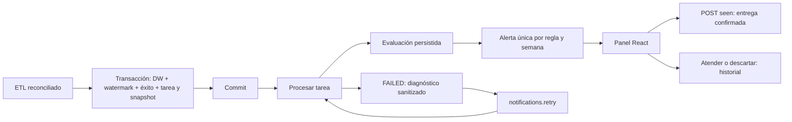

# Alertas automáticas de ventas

Regla `SALES_DROP_WEEKLY`: caída **estrictamente mayor al 15 %** en ventas sin
impuestos de la última semana completa (lunes–domingo) frente a la anterior.
`caída = (referencia − actual) / referencia × 100`. Se ancla a la fecha máxima del
DW. No se comparan semanas parciales, no se evalúa fuera de cobertura y una
referencia cero produce SKIPPED, sin inventar un porcentaje. La ausencia de ventas
dentro de la cobertura reconciliada se considera cero. Este cierre depende de la
completitud de la fuente de ejemplo; no implica calendario de cierres de otra empresa.

En la muestra: 23–29 mayo 2016, 1.015.562,65; referencia 16–22 mayo,
1.074.124,40. Caída real 5,4520 %: CLEAR, sin alerta operacional positiva.

## Flujo y recuperación



`notify.Task.Payload` conserva importes y períodos del DW en la misma transacción
de publicación. No se evalúa un estado cambiante durante un reintento. ETL fallido
revierte tarea y watermark. Un error posterior del evaluador conserva la carga
SUCCEEDED y deja la tarea recuperable; no requiere repetir el ETL.

```powershell
.\.venv\Scripts\python.exe -m deployment.bootstrap
.\.venv\Scripts\python.exe -m etl.run_incremental
# Reintentar tareas pendientes/fallidas, en orden, sin repetir la carga:
.\.venv\Scripts\python.exe -m notifications.retry
# Evento POSITIVO SINTÉTICO para demo, identificado expresamente:
.\.venv\Scripts\python.exe -m notifications.demo --simulate
```

Sin scheduler ni correo: el disparador principal es la carga exitosa y el canal es
el panel local. Si el proceso muere tras commit, ejecutar retry al reiniciar. No se
promete recuperación autónoma mientras el equipo/aplicación está apagado.

Deduplicación: una tarea por ejecución/regla, una evaluación por tarea y una alerta
por regla/semana/indicador de simulación, protegidas por restricciones únicas y
transacción serializable. Repetir tareas exitosas no cambia datos. Un reintento
antiguo no sobrescribe una evaluación posterior del mismo período. Si desaparece
la condición en una corrección del mismo período, NEW/ATTENDED pasa a RESOLVED;
DISCARDED conserva la decisión del operador. Si vuelve, una RESOLVED se reactiva
como NEW. No se resuelve una alerta histórica solo por avanzar a una semana distinta.

Estados del operador: ATTENDED y DISCARDED mediante procedimientos acotados;
historial en notify.StateHistory. API de lectura no puede escribir. La cuenta de
eventos solo ejecuta MarkSeen/ChangeState e inserta auditoría del chat; no puede
leer raw ni modificar hechos. Las rutas requieren la clave de demostración.

Entrega: PENDING hasta que React renderiza y envía POST `/api/alerts/{id}/seen`;
DELIVERED significa visualizada por el panel, no recibida por correo ni leída
personalmente. El acuse es idempotente. Si falla, continúa pendiente y se reintenta
al actualizar. Cada alerta guarda UUID, fecha, severidad WARNING/HIGH (30 % o más),
valores, umbral, ambos períodos, carga origen, regla, evidencia, estado y entrega.

La demo usa referencia real y un valor sintético del 65 % de ella (caída del 35 %),
regla `DEMO_SALES_DROP`, IsSimulated=1 y evidencia con el valor real excluido.
No cambia OLTP, hechos ni predicciones. Se identifica en panel, tareas y reportes.

Pruebas: `tests/test_notifications.py`, bases Test aisladas; disparo/no disparo,
igualdad del umbral, duplicados, rollback ETL, falla del evaluador, reintento,
resolución, permisos y falla transaccional del acuse con recuperación.
`tests/alerts-browser.mjs`: demo marcada, resultado real CLEAR, entrega y estado
desde UI, escritorio/móvil. Evidencias: alert-tests.json, alert-demo.json,
alerts-browser.json y capturas en documentation/evidence/.
